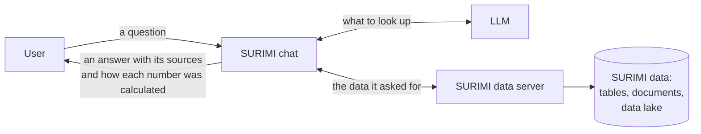

# SURIMI data server

The SURIMI data server (SURIMI-data-mcp) lets users ask questions about fisheries data in their own words
and get answers they can check. It holds the data SURIMI works with: catches and landings, fleet economics
and employment, fishing effort and capacity, stock assessments, fisheries subsidies and survey data. A
policy officer can ask, for instance, which fishing sector is the most profitable in Italy.

Users do not talk to the server directly. They type their question in the SURIMI chat
([SURIMI-vllm-ui](https://github.com/SURIMI-Project/SURIMI-vllm-ui)), and an LLM served by
[SURIMI-vllm](https://github.com/SURIMI-Project/SURIMI-vllm) reads the question, calls the server's tools
and writes the answer. The server is the deliverable (D3.7). The chat and the LLM service are supporting
parts that people need in order to use it in their own language.

The server calculates every total, average and ranking in an answer, and the LLM only reads and writes.
Each number comes with the query that produced it, explained in words, so users can check the number or
run the query again.

This is one of two SURIMI servers. It answers from observed data and from SURIMI's own tables, and its
sibling, [SURIMI-model-mcp](https://github.com/SURIMI-Project/SURIMI-model-mcp), answers from what the
SURIMI simulation models produced.

## What you can ask

These are questions that SURIMI's fisheries experts asked, and that the chat answers:

- "What data is available?"
- "Which fishing sector is the most profitable in Italy?"
- "For which species or groups are there biomass data in the Mediterranean Sea? Where are these data
  taken from?"
- "The results I'm looking at show species only as three-letter codes, like PIL. Which species is this
  code referring to?"

The chat declines one of the experts' questions, because no SURIMI dataset or model holds the answer:

- "An increase in diesel costs in Greece, how will this impact local fishing over the next 10 years?"

When the data cannot answer a question, the server says so and, where it knows, says where such data
would normally be found. It does not fill the gap with a number that only sounds plausible.

## How it works



1. A user asks a question in the SURIMI chat.
2. The LLM decides what it needs, such as a list of datasets, a total, a definition or a document.
3. The chat asks this server, which looks the data up or calculates the number.
4. The LLM writes the answer from what the server returned and names the source.

## Why you can trust a number

Every number the server calculates comes with a calculation record. The record holds a sentence saying
what was calculated from which table, what the dataset catalogue says about that table (whether the data
are observed or simulated, and its warnings and citation), the SQL query with its values filled in, and
the source file. The server writes the sentence from the query it ran, and the LLM does not. Users open
the "Query and re-run" link under an answer, or paste the record into the server's
[audit page](https://project-surimi-surimi-data-mcp.lab.dive.edito.eu/audit), to read the query, copy it,
or have the server run it again on the live data.

The server also signs the record with a key that only the SURIMI servers hold. The signature catches a
number that the LLM changed after the server produced it, and it lets the audit page re-run only queries
that the server itself issued.

The server also says where each dataset came from: the source file, its sha256 fingerprint and the years
it covers. Users can download those files from the
[sources page](https://project-surimi-surimi-data-mcp.lab.dive.edito.eu/sources).

## What it does not do

- It does not run simulations, because model results come from the model server.
- It does not change any data. It can only read.
- It does not read files that users upload or anything on their screen.
- It does not answer from general knowledge when the data is missing.

## Try it

- **On EDITO:** open the [SURIMI chat](https://project-surimi-vllm-ui.lab.dive.edito.eu) and sign in.
- **In another assistant:** the server speaks the Model Context Protocol (MCP), an open standard that lets
  an AI assistant call external tools, so any MCP-compatible client can attach it. Examples are ChatGPT
  Connectors, Claude.ai and Claude Desktop, Mistral Chat, and terminal clients such as opencode. The
  address is `https://project-surimi-surimi-data-mcp.lab.dive.edito.eu/mcp`.

## Learn more

| Document | For whom | What it holds |
|---|---|---|
| [docs/tools.md](docs/tools.md) | Anyone | Each of the server's 20 tools and what it does, with an example question |
| [docs/workshop-cheatsheet.md](docs/workshop-cheatsheet.md) | Anyone with an AI assistant | Attaching the server to Claude or another MCP client in a few steps |
| [data_mcp_architecture.md](data_mcp_architecture.md) | Developers and operators | How the server is built, its interfaces, storage, deployment and configuration |

## Words used here

| Word | Meaning |
|---|---|
| LLM (language model) | The AI that reads your question and writes the answer. In SURIMI it is Muse-Glimmer-30B from Red Hat, running on EDITO. |
| MCP (Model Context Protocol) | A standard way for an AI assistant to use outside tools, such as this server. |
| Calculation record | A signed record of a calculation, so anyone can check a number later. The code and the audit page call it a receipt. |
| Data lake | SURIMI's store of raw data files, kept on EDITO. |
| EDITO | The European Digital Twin of the Ocean platform, where SURIMI's services run. |

---

## For operators

### Endpoints

| Path | Use |
|---|---|
| `/mcp` | MCP over Streamable HTTP, for MCP clients such as Claude or ChatGPT Connectors and for the SURIMI chat |
| `/sse` | MCP over server-sent events, kept for clients that need it |
| `/audit` | How a number was calculated: its query, source and a re-run, in the browser |
| `/sources` | The source files behind each dataset |
| `/sources/lake` | The data lake copy (SURIMI Keycloak sign-in) |

The server listens on port 26610. On EDITO it is at `https://project-surimi-surimi-data-mcp.lab.dive.edito.eu`.

### Image

GitHub Actions publishes the image to `ghcr.io/surimi-project/surimidatamcp`, as `latest` on every push to
`master` and as `<version>` for each `v<version>` tag. The image holds code only. On EDITO the data, the
documents and the cube are fetched from the SURIMI bucket at launch.

```
docker pull ghcr.io/surimi-project/surimidatamcp:latest
```

### Deployment

The Helm chart lives in the EDITO Onyxia catalogue:
`https://datalab.dive.edito.eu/catalog/service-playground`

Source: `gitlab.mercator-ocean.fr/pub/edito-infra/service-playground`, directory `surimi-data-mcp/`

### Debugging a stuck or failed deploy

The chart ships a diagnostic script at `/app/scripts/debug-mcp.sh` inside the image.
It dumps helm status, pod descriptions, server logs, load-data Job logs, postgres
logs, and recent namespace events in one shot. Run it from the terminal sidecar
(or any pod with kubectl + helm access to the namespace):

```
kubectl exec -it <surimi-terminal-pod> -- bash /app/scripts/debug-mcp.sh
```

Or copy it out and run from a debugging pod:

```
kubectl cp <surimi-data-mcp-pod>:/app/scripts/debug-mcp.sh /tmp/debug-mcp.sh
bash /tmp/debug-mcp.sh <release-name>
```

Quick manual checks:

```
helm status <release>                                          # release-level state
kubectl get pod -l app.kubernetes.io/instance=<release>        # pod state
kubectl describe pod <pod>                                     # why pending/crashed
kubectl logs job/<release>-load-data-r<revision> -c load-csv --tail=200 -f  # live data-load
kubectl logs -l app.kubernetes.io/instance=<release> -c surimi-data-mcp --tail=80
kubectl get events --sort-by=.lastTimestamp | tail -20
```

The image sets `PYTHONUNBUFFERED=1`, so all `print()` output streams to the logs in real time.

### Local development

The local database needs a password of your choice, which `docker compose` refuses to start without.
The database port is open on localhost only.

```
export SURIMI_DB_PASSWORD=<choose one>
docker compose up -d
# MCP endpoint: http://localhost:26610/mcp
```

Tests:

```
pip install -e ".[dev]" psycopg2-binary
PYTHONPATH=. python -m pytest tests/ -q -m "not live"
```

## Licence

EUPL-1.2. See [LICENSE](LICENSE).
