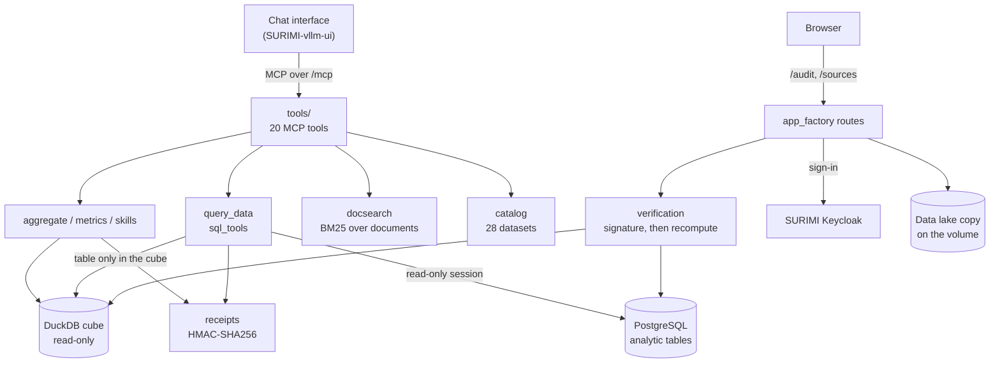
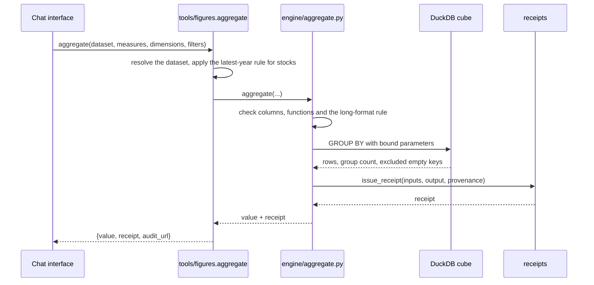

# SURIMI data MCP server: Architecture

This is the technical description for developers and operators. The [README](README.md) introduces the
server in everyday language, and [docs/tools.md](docs/tools.md) lists each tool and what it does.

## Overview

SURIMI-data-mcp is the data server of SURIMI and the deliverable D3.7. It lets users ask questions about the
tabular data SURIMI works with in their own words, for example how much Spain landed in 2022. The data covers
EU DCF fleet economics, capacity, effort and catches, FAO and ICES landings, ICES stock assessments, OECD
fisheries support, MEDITS survey indices and the SURIMI project tables. The server answers through the Model
Context Protocol (MCP), so any MCP client can use it.

Users do not talk to the server directly. They type their question in the chat
([SURIMI-vllm-ui](https://github.com/SURIMI-Project/SURIMI-vllm-ui)), and an LLM served by SURIMI-vllm reads
the question, calls the server's tools and writes the answer. The chat and the LLM service are supporting
parts and not part of the deliverable.

The LLM does not calculate anything. For a question about total landings, it calls the `aggregate` tool. The
server sums the rows in an embedded DuckDB database (the cube) and returns the total with a calculation
record, called a `receipt` in the code. The record is signed with HMAC, and anyone can check it again on the
server's audit page.

The server also searches the SURIMI documents and describes each dataset and where it came from. It serves a
read-only copy of the SURIMI data lake to users who have signed in. Gridded model output comes from a separate
server, [SURIMI-model-mcp](https://github.com/SURIMI-Project/SURIMI-model-mcp), and the chat attaches both
servers at once.

The service is written in Python 3.12 on FastMCP 3.3.1, and uvicorn and Starlette serve it. It runs on the
EDITO Datalab as one container beside a PostgreSQL database.

### Licence

EUPL-1.2.

---

## Responsibilities

- Keep a catalogue of the 28 datasets it serves, with each dataset's table and columns, whether it is
  observed or modelled, its years where the sources manifest records them, and a citation where one is
  recorded.
- Calculate exact aggregates (`aggregate`), 18 named metrics (`query_metric`) and read-only SQL
  (`query_data`), and sign every result.
- Run whole analyses on the server, namely trends, country comparisons, breakdowns, reports and provenance.
- Refuse a request that would give a wrong number. Two examples are a sum across different measures of a
  long-format table and landings counted twice across two tables of the same catch.
- Search the SURIMI documents and return verbatim passages with their source.
- Say where each dataset came from, with the source file, its sha256 and the years it covers.
- Say what SURIMI's documentation records about what the data was used for.
- Verify calculation records, and recompute the `aggregate` and `query_data` records on request.
- Serve the source files behind each dataset, a copy of the data lake and the supporting files of the
  evaluation. The last two need sign-in.
- Describe itself, including its data sources, its tools and what each source cannot answer.

### Build outputs

| Output | Description |
|---|---|
| `ghcr.io/surimi-project/surimidatamcp:<version>` | Container image, started as `python -m surimi_data_mcp`. Code only: data, documents and the cube are fetched on EDITO at launch. |

---

## Interfaces

The server registers 20 MCP tools in five modules under `surimi_data_mcp/tools/`, and it has no MCP resources
or prompts. A check at start-up confirms that every tool belongs to one of the 10 data sources declared in
`surimi_data_mcp/sources.py`.

### Transports

| Path | Protocol | Use |
|---|---|---|
| `/mcp` | Streamable HTTP | MCP clients such as Claude and ChatGPT Connectors. |
| `/sse`, `/messages` | Server-sent events | Clients that need SSE. The SURIMI chat connects to `/mcp`. |

The server listens on port 26610.

### Tools

| Tool | Signed | What it returns |
|---|---|---|
| `describe_data_capabilities` | | Data sources, the tools that read them, usage hints and what each source cannot answer. |
| `list_datasets` | | The dataset catalogue, flags for datasets the cube cannot serve, and `documented_use`. |
| `list_columns` | | A dataset's columns and types, read from the live database. |
| `describe_table` | | The columns of a table. |
| `explain_indicator` | | Definition, unit and source of an indicator. |
| `explain_species_code` | | The scientific name behind a species code. |
| `data_list_functional_groups` | | Ecopath functional groups, or the species in one group. |
| `search_documents` | | Verbatim passages from the SURIMI documents, with their source. |
| `describe_models` | | What the SURIMI models (EwE, CMSY++, POSEIDON, the market model and others) do. |
| `analyze_trend` | yes | A metric's trend over time, optionally per group. |
| `compare_countries` | yes | A metric ranked across countries. |
| `generate_report` | yes | An overview, the key metric and its provenance. |
| `explain_provenance` | yes | Where a dataset comes from, from the documents and the build manifest. |
| `breakdown` | yes | A metric or a row count by category, as a chart. |
| `list_metrics` | | The named metrics, with additivity, unit and dimensions. |
| `query_metric` | yes | One named metric, grouped and filtered. |
| `query_data` | yes | Rows from one read-only SQL query. |
| `describe_quality` | | Missing values, confidential cells and year gaps per column. |
| `aggregate` | yes | Exact sums, averages, counts, minima and maxima, grouped and filtered. |
| `verify` | | Whether a calculation record is genuine and, for `aggregate` and `query_data`, whether the number recomputes. |

`aggregate` and `query_data` return `{value, receipt, audit_url}`. `query_metric` returns
`{value, receipt, audit_urls}`, and the analyses and `explain_provenance` return a `receipts` list with a
matching `audit_urls` list. An audit link opens the calculation record on the server's audit page.

### HTTP routes

| Path | Method | Returns | Sign-in |
|---|---|---|---|
| `/audit` | GET | The calculation record verification page. | none |
| `/audit/verify` | POST | Verification of a calculation record, with recompute on request. | none |
| `/audit/receipt/{signature}` | GET | A stored calculation record, byte for byte. | none |
| `/audit/dataset/{dataset_id}` | GET | The audit page of one dataset. | none |
| `/audit/experts`, `/audit/experts/{version}`, `/audit/experts/index.json` | GET | The expert evaluation pages, newest first, and their index. The pages are not part of this repository; without them each route answers 404. | none |
| `/sources` | GET | The sources manifest with each dataset's source file, hash and years. | none |
| `/sources/{file}` | GET | One source file named in the manifest. | none |
| `/sources/lake`, `/sources/lake/{path}` | GET | The index of the data lake copy and its files. | SURIMI Keycloak |
| `/sources/repo/...` | GET | The supporting files of the evaluation. | SURIMI Keycloak |
| `/sources/auth/login`, `/callback`, `/logout` | GET | Browser sign-in through the SURIMI Keycloak. | n/a |

The lake accepts a Keycloak access token or a browser session, and the supporting files under `/sources/repo`
accept a browser session only. A token must be signed by the SURIMI realm, must not have expired and must be
issued to the expected client. When a role is configured, it must also carry that role, for example
`lake-reader`. With no realm configured, the lake refuses every request with status 503, unless
`SURIMI_LAKE_ALLOW_ANONYMOUS=true`.

---

## Method

The server does not run a model. It answers questions about observed and modelled tables, and the LLM never
does the arithmetic.

**The cube.** At launch the server opens a DuckDB file that holds one table per source CSV, with consistent
types and lower-case column names, plus seven curated views. If a CSV on the volume has no table in the cube,
the server rebuilds the cube before the first query. It opens the cube read-only.

**Aggregation.** `aggregate` builds the GROUP BY itself. It checks column names against the table, binds
filter values as parameters and allows only sum, avg, count, min, max and count_distinct. Rows with an empty
group key are left out and counted. A per-year stock such as vessel numbers or capacity is taken for the
latest year unless the request gives a year, so stocks are never summed across years. On a long-format table,
where one column holds many different measures, a sum, average, minimum or maximum needs one `variable_code`, so different
measures are never added together. The result reports the number of groups and any truncation.

**Named metrics.** A metric fixes its table, measure, aggregation, additivity, unit and dimensions, so
`query_metric` cannot apply the wrong aggregation to a measure. Each result carries the metric's origin and
the years it covers.

**SQL.** `query_data` accepts one read-only query. That is a single SELECT (including `WITH ... SELECT` and
`UNION`) or `SHOW`, parsed with sqlglot, with no write anywhere in it. The server refuses anything else before
it runs. The query goes to PostgreSQL in a read-only session with a 60-second time limit, and a table that
exists only in the cube is answered from the cube.

**Documents.** `search_documents` ranks passages with BM25 over an SQLite full-text index of the SURIMI
documents (Markdown, text, reStructuredText and PDF), split into passages of up to 1,400 characters. The index
leaves out internal wiki and meeting-note paths. Passages come back verbatim, so users can check a quotation
against its source.

**Calculation records.** A record holds the tool name, its inputs, its output, a timestamp and the
provenance, signed with HMAC-SHA256 over canonical JSON. The signing key is `SURIMI_RECEIPT_SECRET`, and
SURIMI-model-mcp shares it, so one verify flow serves both servers. Verification checks the signature first
and never recomputes a record whose signature fails. For `aggregate` and `query_data` it can run the stored
query again and compare the rows. Records too long for a link are kept in a bounded in-memory store and linked
by their signature.

**Sources.** `sources_manifest.json` records each dataset's source file, sha256, row count and the years found
in it. The manifest is attached to `explain_provenance` and to the provenance of each record, together with
the sha256 of the cube.

---

## Service architecture

The code is one package, `surimi_data_mcp`. `server.py` imports the data-source declarations (`sources.py`)
and the five tool modules (`tools/`), which register on the FastMCP instance in `mcp_server.py`, and its
`main()` runs the check and serves the app. `app_factory.py` builds one Starlette app that holds both MCP
transports and every HTTP route. On start-up it hashes the cube for the calculation records in a worker
thread before serving, and it starts the copy of the data lake in the background. The cube and the document
index are opened on first use and not at import.

### High-level architecture



### Request flow for `aggregate`



### Start-up

1. The server registers the capability records and the 20 tools, then runs the check. It logs a mismatch and
   keeps running.
2. Before serving, it hashes the cube for the calculation records in a worker thread, and it logs a failure
   and starts anyway. Then it starts copying the data lake to the volume in the background.
3. On the first data call it opens the cube, and it rebuilds the cube if a CSV on the volume is missing from
   it.

### Key design decisions

| Decision | Rationale |
|---|---|
| The LLM never sums, averages, ranks or counts rows | A model that calculates in prose can give wrong numbers. The server calculates and signs every number. |
| Calculation records instead of proofs | A signed record of inputs and output is enough to check a number later, and anyone can run it again. |
| A bad signature is never recomputed | Recompute runs only on records the server itself issued. |
| BM25 over full text, not embeddings | It needs no GPU and returns passages that users can quote exactly. |
| Both MCP transports in one process | The SURIMI chat and most MCP clients use Streamable HTTP, and SSE stays for clients that need it. |
| Routes under existing prefixes | The EDITO ingress forwards a fixed list of paths, so new pages live under `/audit` and `/sources`. |
| Steer an aggregate SQL query instead of refusing it | The query runs and is signed, and the result carries a note that points to `aggregate`. |
| Read-only SQL in two places | The server checks the query before it runs, and the database session is read-only as well. |
| The image holds code only | Data, documents and the cube are fetched from EDITO at launch, so a data change needs no new image. |

---

## Error handling

- `aggregate` returns `{"error": ..., "value": null, "receipt": null}` for an invalid request, so no number is
  invented to fill the gap.
- The analyses and metrics return `{"error": ..., "receipts": []}`, and `query_metric` also lists the valid
  metric names.
- A database error from `query_data` comes back in `value.error`, with the table's real columns when a column
  name was wrong, so the LLM can correct itself.
- The server refuses a query that is not a single read, a sum across different measures, and landings counted
  across both landings tables before it runs, with a message that says what to send instead.
- A signed tool does not run without `SURIMI_RECEIPT_SECRET`. The exception is `explain_provenance`, which
  then answers with no calculation record, and `verify` answers `secret_not_configured`.
- Optional parts fail open. The dataset list skips the cube check, column lists come from the static
  catalogue, provenance goes without the manifest, and the document search returns nothing.
- Access fails closed. The lake refuses every request when no sign-in realm is configured (unless
  `SURIMI_LAKE_ALLOW_ANONYMOUS=true`), and only files named in a manifest can be downloaded.
- The public verify route rejects oversized or malformed input with status 400 or 413, and it never shows the
  database's own error text.

---

## Logging

- The server prints tool calls to standard output with the prefix `[surimi-mcp]`, the tool name and its key
  arguments. The `query_data` log line cuts the SQL to 80 characters.
- The modules for the cube, sources, the lake, sign-in and verification use Python's `logging` for warnings.
- The image sets `PYTHONUNBUFFERED=1`, so output reaches the pod log at once.

---

## S3 bucket

The server reads the SURIMI bucket on EDITO MinIO (`project-surimi`, endpoint
`https://minio.dive.edito.eu`) and never writes to it.

| Path | Content | Used by |
|---|---|---|
| `mcp_data/tables/` | The analytic CSVs. | Loaded into PostgreSQL, and copied to the volume for the cube and `/sources`. |
| `mcp_data/docs/` | The SURIMI documents. | The document search. |
| `mcp_data/cube/` | The prebuilt cube and `sources_manifest.json`. | Copied to the volume at launch. |
| `mcp_data/data/` | The data lake copy and `lake_manifest.json`. | `/sources/lake`. |

### Local volume

Everything the server reads sits on one persistent volume mounted at `/surimi`. It holds the cube
(`cube.duckdb`), the documents, the sources manifest, the source CSVs and the copy of the data lake. The
launch step skips anything already there, so a restart does not depend on the storage token. The lake copy
checks each file's size and sha256 before keeping it. It needs free space for the files still missing plus
512 MiB, and it retries every six hours while files are missing.

### S3 bucket authentication

The EDITO launcher injects a temporary storage token, valid for about 24 hours, into the Secret
`<release>-s3`.

| Variable | Purpose |
|---|---|
| `AWS_ENDPOINT_URL` | MinIO endpoint. |
| `AWS_ACCESS_KEY_ID` | Access key. |
| `AWS_SECRET_ACCESS_KEY` | Secret key. |
| `AWS_SESSION_TOKEN` | Temporary session token. |

After the token expires, the server keeps answering from the volume. New data reaches it on the next launch
with a fresh token.

---

## Kubernetes

The server is launched from the `surimi-data-mcp` chart in the EDITO service catalogue (the
`service-playground` catalogue).

| Item | Value |
|---|---|
| Image | `ghcr.io/surimi-project/surimidatamcp:<version>` |
| Port | 26610, service name `mcp` |
| Ingress | `/mcp`, `/sse`, `/messages`, `/status`, `/audit`, `/sources`, with TLS and one-hour read timeouts for streaming |
| Init container | `fetch-cube-docs` copies the cube, documents, manifest and CSVs to the volume and skips what is there |
| Data job | `load-data` loads the analytic CSVs into PostgreSQL |
| Volume | 25 Gi persistent volume at `/surimi`, which also holds the 11.8 GB lake copy |
| Database | PostgreSQL 16 (Bitnami chart) with a 2 Gi volume, reachable only from the server's pods |
| Update strategy | `Recreate`, because the volume can be attached to one pod at a time |
| Probes | TCP checks, because the MCP paths are streaming endpoints |
| Resources | Request 100m CPU and 256 Mi memory, limit 1 CPU and 1 Gi memory |
| Secrets | `<release>-s3` (storage token), `<release>-receipts` (signing key, kept across upgrades) |
| Sidecar | An optional terminal for operators, enabled by default |

The chart takes the signing key from the release's own secret, or else from another secret in the namespace
that holds the same key. The data server and the model server therefore sign with the same key.

---

## Environment variables

| Variable | Default | Purpose |
|---|---|---|
| `SURIMI_RECEIPT_SECRET` | none | The key used to sign calculation records. Required for signed tools. |
| `SURIMI_PUBLIC_BASE_URL` | none | Base of `audit_url` links and of the sign-in redirect. |
| `SURIMI_CUBE_DB` | `:memory:` | The cube file (`/surimi/cube.duckdb` on EDITO). |
| `SURIMI_DATA_DIR` | `data/exports` | Source CSVs for the cube and `/sources`. |
| `SURIMI_DOCS_DIRS` | `references` and `references/SURIMI-project.wiki`, where they exist | Document directories for the search. |
| `SURIMI_DOCS_DB` | `:memory:` | The search index file. |
| `SURIMI_SOURCES_MANIFEST` | beside the cube | The sources manifest. |
| `SURIMI_SOURCE_BASE_URL` | none | Base of the download link in the sources record. |
| `SURIMI_SOURCES_S3` | none | Bucket prefix for `/sources/{file}` when the file is not on the volume. |
| `DB_BACKEND` | `trino` | `postgres` on EDITO. |
| `DATABASE_URL` | local development URL | PostgreSQL connection. |
| `TRINO_HOST`, `TRINO_PORT`, `TRINO_CATALOG` | `127.0.0.1`, `8081`, `hive` | Trino connection, for partner databases. |
| `AWS_ENDPOINT_URL` and the `AWS_*` credentials | none | Storage access. |
| `SURIMI_LAKE_S3` | none | Bucket prefix of the data lake copy. |
| `SURIMI_LAKE_CACHE` | none | Volume directory for the lake copy. |
| `SURIMI_LAKE_DIR` | none | Local directory that holds the lake and `lake_manifest.json`, used instead of the bucket. |
| `SURIMI_LAKE_OIDC_ISSUER` | none | Keycloak realm. Without it the lake refuses every request. |
| `SURIMI_LAKE_ALLOW_ANONYMOUS` | unset | `true` serves the lake without sign-in when no realm is set. |
| `SURIMI_LAKE_OIDC_AUDIENCE` | none | Client the access token must be issued to. |
| `SURIMI_LAKE_OIDC_ROLE` | none | Required role, for example `lake-reader`. |
| `SURIMI_WEB_OIDC_CLIENT` | `surimi-data-mcp-web` | Client used for browser sign-in. |
| `SURIMI_SESSION_SECRET` | the signing key | Key for the browser session cookie. |
| `SURIMI_REPO_DIR` | `/app/audit-repro` | Files served under `/sources/repo`. |

The load job reads `SURIMI_DATA_SRC`, `SURIMI_DOCS_SRC` and `SURIMI_BUILD_CUBE`.

---

## CI/CD

### GitHub Actions

| Workflow | Trigger | What it does |
|---|---|---|
| **Tests** (`test.yml`) | Push to `master`, pull request, manual, or called by another workflow | Installs the package with its development extras on Python 3.12 and runs `pytest tests/ -q -m "not live"`. |
| **Build and Push Docker Image** (`docker.yml`) | Push to `master`, tag `v*`, manual | Runs the tests first, then builds the image and pushes it to the GitHub Container Registry. |

### Docker image

The image is built from `python:3.12-slim` and holds code only. Every push to `master` tags it `latest`, and a
`v<version>` tag also tags it `<version>`, as `ghcr.io/surimi-project/surimidatamcp`. The EDITO chart pins a
version tag.

---

## Technology stack

| Package | Role |
|---|---|
| `fastmcp` 3.3.1 | MCP server framework. |
| `uvicorn`, `starlette` | Web server and the app with the HTTP routes. |
| `duckdb` | The embedded cube. |
| `psycopg2-binary` | PostgreSQL client and loader. |
| `trino` | Trino client, for partner databases. |
| `sqlglot` | Parsing SQL for the read-only check. |
| `boto3` | Storage access. |
| `PyJWT` | Checking Keycloak access tokens. |
| `markdown` | Rendering the supporting files. |
| `numpy` | Numeric support. |
| `pyyaml` | Reading the dataset catalogue, `surimi_data_mcp/datasets/datasets.yaml`. |
| `sqlite3` (standard library) | The full-text document index. |
| `pytest`, `pytest-asyncio`, `moto` | Tests. |

---

## Project structure

```
SURIMI-data-mcp/
├── surimi_data_mcp/            # the server, one package
│   ├── __main__.py             # `python -m surimi_data_mcp` starts it
│   ├── server.py               # registers the tools, runs the drift check, serves the app
│   ├── mcp_server.py           # the FastMCP instance and the server log
│   ├── sources.py              # the 10 data sources: what each holds, which tools read it, what it cannot answer
│   ├── capabilities.py         # the capability registry and drift check
│   ├── app_factory.py          # Starlette app: both MCP transports and every HTTP route
│   ├── paths.py                # where static/, data/ and audit-repro/ are
│   ├── tools/                  # the 20 tools, by group
│   │   ├── discovery.py        #   what exists: sources, datasets, columns, tables, metrics, quality
│   │   ├── figures.py          #   signed figures: aggregate, query_metric, query_data
│   │   ├── analyses.py         #   trend, country comparison, report, breakdown
│   │   ├── explain.py          #   indicators, species codes, groups, documents, models, provenance
│   │   ├── verify.py           #   receipt verification
│   │   └── common.py           #   helpers the tool modules share
│   ├── datasets/               # what the data is
│   │   ├── datasets.yaml       #   the 28 datasets, with the reasons for each entry
│   │   ├── catalog.py          #   lookups over the catalogue, documented use
│   │   ├── metrics.py          #   the 18 named metrics
│   │   ├── semantic_views.py   #   the 7 curated cube views
│   │   ├── wide_years.py       #   tables whose years are columns
│   │   └── quality.py          #   missing values, confidential cells, year gaps
│   ├── engine/                 # how a number is computed
│   │   ├── cube.py             #   build, open and stale check of the DuckDB cube
│   │   ├── aggregate.py        #   exact aggregation with receipts
│   │   ├── skills.py           #   the server-run analyses
│   │   ├── sql_tools.py        #   signed query_data, read-only check, refusals, cube fallback
│   │   └── databases.py        #   PostgreSQL and Trino clients
│   ├── provenance/             # how a number can be checked
│   │   ├── receipts.py         #   canonical JSON and HMAC-SHA256 signing
│   │   ├── signed_tool.py      #   receipt wrapper
│   │   ├── verification.py     #   signature check and recompute
│   │   ├── lineage.py          #   sources manifest and cube hash
│   │   ├── receipt_store.py, audit_link.py, human_check.py
│   ├── knowledge/              # documents and reference
│   │   ├── docsearch.py        #   BM25 document search
│   │   ├── models.py           #   descriptions of the SURIMI models
│   │   └── lookups.py          #   indicators, species codes, functional groups
│   ├── web/                    # HTTP pages and downloads
│   │   ├── audit_routes.py, experts_routes.py, sources_routes.py
│   │   └── lake_routes.py, lake_auth.py, lake_cache.py, web_auth.py   # data lake copy and sign-in
│   └── loader/                 # the data-load job
│       ├── bootstrap.py        #   entry point (`python -m surimi_data_mcp.loader.bootstrap`)
│       ├── load_csv.py         #   CSV loader and header rules
│       └── fleet_economics.py  #   builds the fleet-economics table (scripts/build_fleet_economics.py)
├── data/                       # schema DDL and vocabularies
├── static/                     # audit page
├── audit-repro/                # fetch_lake.py, which downloads lake files from the server
├── scripts/                    # manifest, lake publishing and diagnostics
├── tests/                      # pytest suite
├── docs/                       # guides in everyday language
├── Dockerfile, docker-compose.yml, pyproject.toml
└── .github/workflows/          # test.yml, docker.yml
```

---

## Source control

The code is hosted on GitHub at [SURIMI-Project/SURIMI-data-mcp](https://github.com/SURIMI-Project/SURIMI-data-mcp).
The default branch is `master`. Releases are tagged `vMAJOR.MINOR.PATCH`, and the tag is the image version
that the EDITO chart pins. There are no submodules.

---

## Testing

Tests live in `tests/` (96 test files) and use pytest. Tests marked `live` need a Trino with the SURIMI
catalogue, and CI skips them.

```bash
pip install -e ".[dev]" psycopg2-binary
PYTHONPATH=. python -m pytest tests/ -q -m "not live"
```

`tests/test_dockerfile_copies_modules.py` checks that the image copies the whole package, starts it with
`python -m`, and that no Python module sits at the repository root. `tests/test_query_data_read_only.py`
checks that `query_data` refuses anything that could write.

To run the server locally with the bundled PostgreSQL, use the following. `docker compose` refuses to
start without `SURIMI_DB_PASSWORD`, and the database port is open on localhost only.

```bash
export SURIMI_DB_PASSWORD=<choose one>
docker compose up -d
# MCP endpoint: http://localhost:26610/mcp
```
