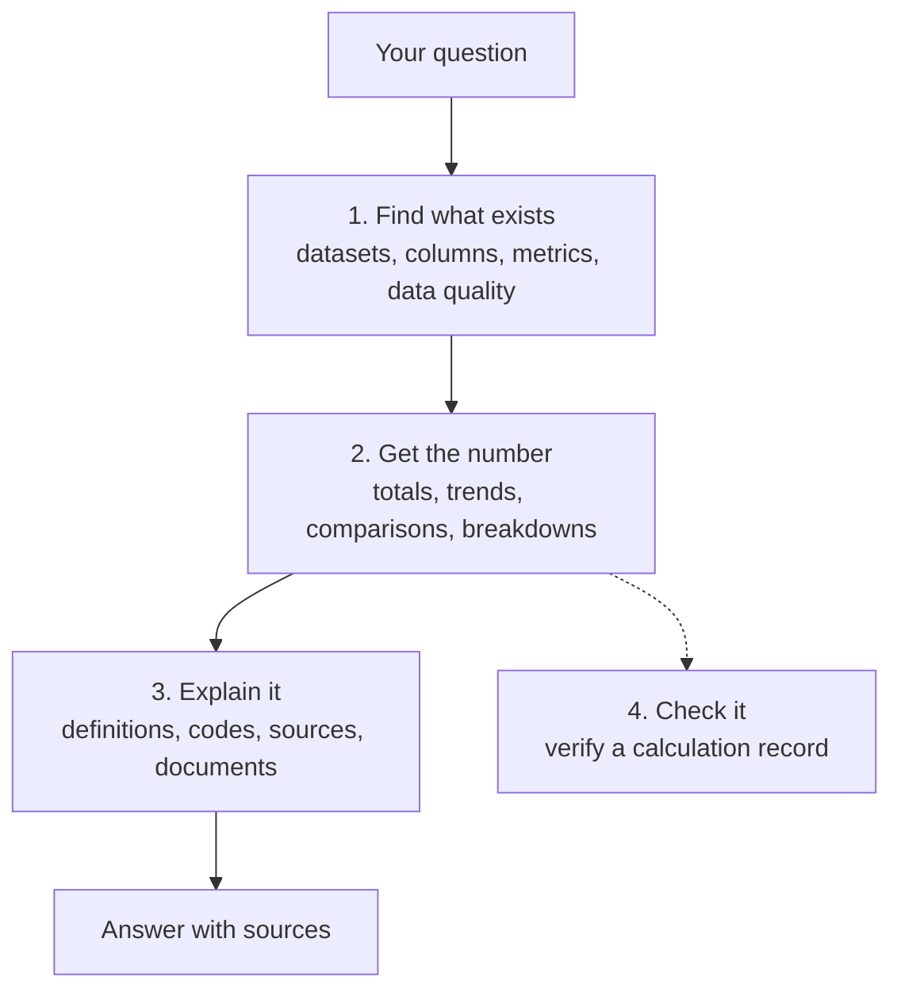

# What the SURIMI data server can do

SURIMI-data-mcp is the data server of the SURIMI chat, and it has 20 functions, called tools. Users do not call them. The LLM in the chat picks the tools it needs to answer a question, so this page lists what the chat can look up and what it cannot. A policy officer can ask, for example, how many vessels each country had in 2022, and the LLM answers it with the `aggregate` tool.

Tools marked "with calculation record" return a sentence that the server writes from the query it ran, the SQL query with its values filled in, and the source file, where there is one. The record is signed, so a number changed afterwards is caught. Users can read the record, copy the query or run it again on the server's [audit page](https://project-surimi-surimi-data-mcp.lab.dive.edito.eu/audit). In the tool results the record is called `receipt`.

The architecture document describes how the server is built: [data_mcp_architecture.md](../data_mcp_architecture.md).

## 1. Finding out what exists

| Tool | What it answers | Example question |
|---|---|---|
| `describe_data_capabilities` | What the server holds, which tools read it, and which kinds of question it cannot answer and why. | "What can this tool do?" |
| `list_datasets` | The 28 datasets, with each one's table, whether it is observed or modelled, the years its source covers where the server could read them, and a citation where one is recorded. It also gives what SURIMI's documentation records about what each dataset was used for. | "What data is available?" |
| `list_columns` | The columns of one dataset and the kind of value each holds. | "What is recorded in the fleet capacity data?" |
| `describe_table` | The columns of a table, looked up by its database name. It reads the database only, so a miss does not mean the data is absent, and `list_columns` is the better first choice. | |
| `describe_quality` | How complete a dataset is: missing values per column, values withheld as confidential, and missing years. | "How complete is the fishing effort data?" |
| `list_metrics` | The 18 ready-made measures, such as net profit, vessel numbers or women employed, with their unit and how they may be added up. | "Which indicators can you compute?" |

## 2. Getting a number

| Tool | What it answers | Example question |
|---|---|---|
| `aggregate` (with calculation record) | Exact totals, averages, counts, minima and maxima, for any grouping and filter. For values that must not be added across years, such as the number of vessels, it takes the latest year unless a year is given. | "How many vessels did each country have in 2022?" |
| `query_metric` (with calculation record) | One of the ready-made measures, grouped and filtered. | "Net profit of the Italian fleet by fishing technique." |
| `query_data` (with calculation record) | One read-only SQL query, for questions the other tools cannot express. It refuses queries that could change data. | |
| `analyze_trend` (with calculation record) | How a measure changed over time, overall or per group. | "How has fuel cost changed in the Italian fleet?" |
| `compare_countries` (with calculation record) | A measure ranked across countries, for a chosen period. | "Which country spends most on fuel?" |
| `breakdown` (with calculation record) | A measure, or a row count, split by a category and returned with a bar chart. | "Fishing effort by gear type." |
| `generate_report` (with calculation record) | A short report on one dataset with an overview, a key measure and where the data came from. | "Give me an overview of the Aegean economic performance data." |

## 3. Explaining

| Tool | What it answers | Example question |
|---|---|---|
| `explain_indicator` | What an indicator means, with its unit and its source. | "What does fuel_efficiency mean?" |
| `explain_species_code` | The species behind a three-letter code. | "Which species is PIL?" |
| `data_list_functional_groups` | The groups of species used in the ecosystem model, or the species in one group. | "Which species are in the mesopelagic fishes group?" |
| `describe_models` | What each model in the SURIMI ensemble does, such as Ecopath with Ecosim, CMSY++ and POSEIDON. | "What does POSEIDON simulate?" |
| `search_documents` | Passages from the SURIMI documents, quoted word for word with their source. | "How was the OECD support estimate built?" |
| `explain_provenance` (with calculation record) | Where a dataset came from: passages from the documents about it, and its source file, file fingerprint, row count and years. | "Where does the biomass data come from?" |

## 4. Checking

| Tool | What it answers |
|---|---|
| `verify` | Whether a calculation record is genuine. For records from `aggregate` and `query_data`, it can also calculate the number again from the live data and compare. Records from SURIMI-model-mcp are checked by their signature only. |

## What the answers will not contain

- **A number the server did not calculate.** The LLM is told to report the server's numbers, and each one carries a calculation record.
- **A sum across different measures.** Some tables store several measures in one column, and the server refuses to add them together.
- **The same catch counted twice.** Landings appear in two tables at different levels of detail, and `query_data` refuses a total over both.
- **An answer from general knowledge** when the documents do not cover the question. `search_documents` and `explain_provenance` then say that the documents do not cover it.
